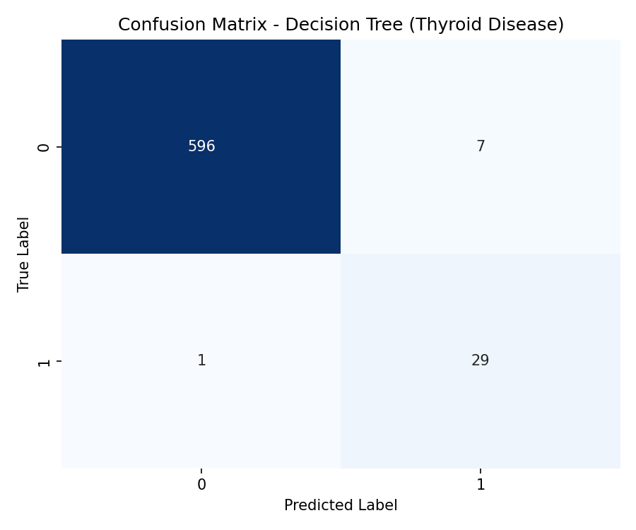
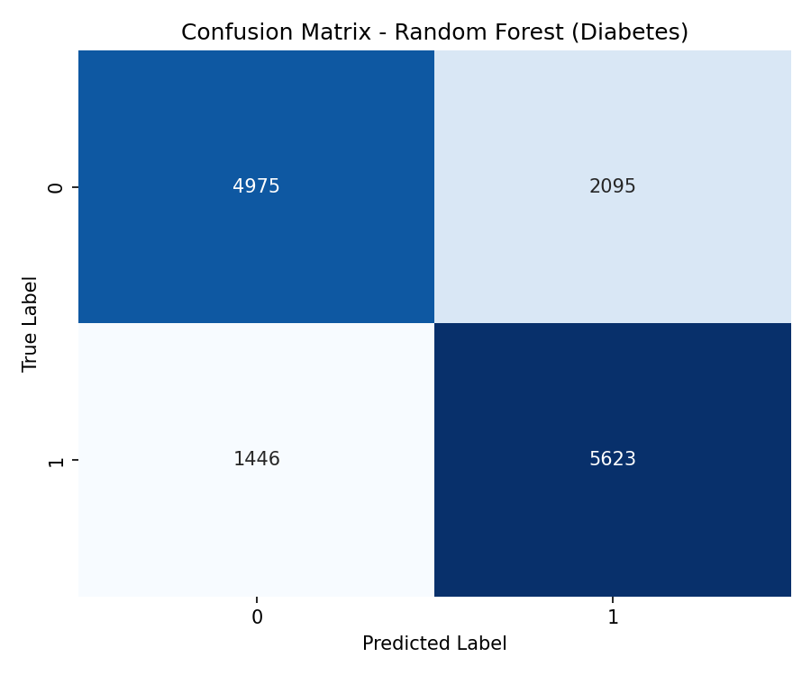
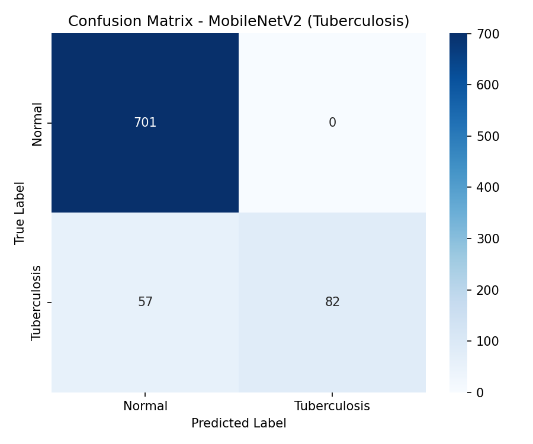
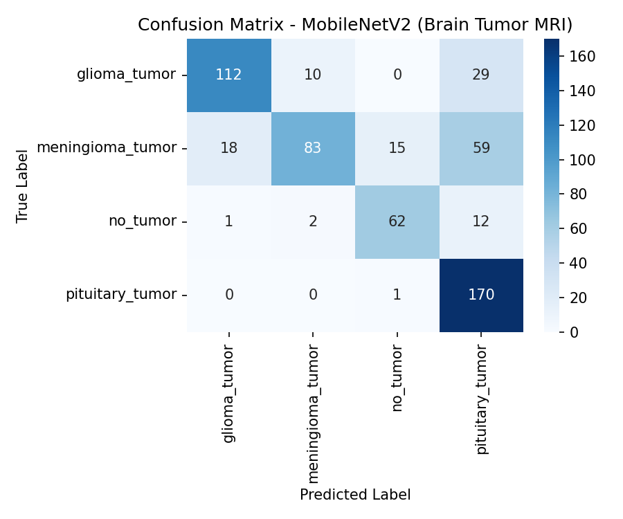
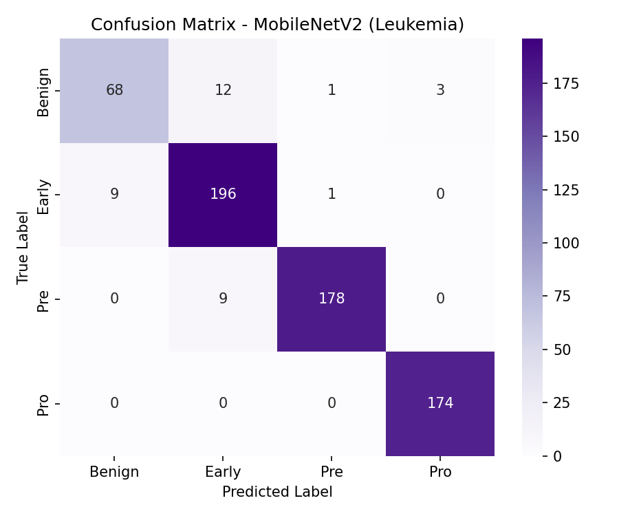

# ArogyaDrishti (आरोग्यदृष्टि)
### Multi-Disease Detection, Classification & Health Recommendation System

[](https://www.python.org/)
[](https://opensource.org/licenses/MIT)
[]()

---

## 📌 Project Overview

**ArogyaDrishti** is an integrated AI-assisted healthcare platform designed for **Multi-Disease Detection, Classification, and Evidence-Based Health Guidance**. 

The system operates across three distinct modular phases:
1. **Dataset Ingestion & Organization Phase**: Scans, categorizes, and organizes diverse medical datasets (Tabular, Medical Imaging, Cell Scans) across major organ systems.
2. **ML Classification Phase**: Detects and predicts disease classifications along with prediction confidence metrics.
3. **Knowledge-Based Recommendation Phase**: A safe, deterministic, rule-based recommendation engine utilizing structured JSON knowledge bases to provide comprehensive, evidence-based lifestyle, dietary, exercise, and medical consultation guidance.

---

## 📁 Repository Architecture

```text
ArogyaDrishti/
│
├── .gitignore                                 # Excludes heavy datasets and temporary files
├── README.md                                  # Main project documentation (Single Source of Truth)
│
├── dataset organizer/
│   └── dataset_organizer.py                   # Automated script to categorize raw medical datasets
│
└── ML_Project/
    │
    ├── Models/                                # Directory reserved for trained ML model artifacts (.pkl, .h5)
    │   └── .gitkeep
    │
    └── Recommendation_System/                 # Knowledge-based recommendation subsystem
        ├── recommendation_system.py           # Core recommendation program with CLI & API interface
        ├── disease_information.json           # Comprehensive JSON knowledge base (34 conditions)
        └── test_recommendation_system.py      # Automated test suite covering 10 test scenarios
```

> 

---

## 📊 Dataset Ingestion & Coverage Summary

The system is configured to ingest and structure datasets across 10 medical categories covering 18 primary conditions:

| # | Disease / Condition | Local Dataset | Data Format | Medical Category |
| :- | :--- | :--- | :--- | :--- |
| 1 | **Diabetes** | Diabetes Health Indicators (BRFSS2015) & Hospital 130-US | Tabular (`.csv`) | `Endocrine_Metabolic` |
| 2 | **Heart Disease** | Heart Disease (Cleveland, Hungarian) & Statlog | Tabular (`.data`, `.dat`) | `Cardiovascular` |
| 3 | **Heart Failure** | Heart Failure Clinical Records | Tabular (`.csv`) | `Cardiovascular` |
| 4 | **Stroke** | Healthcare Dataset Stroke Data | Tabular (`.csv`) | `Cardiovascular` |
| 5 | **Alzheimer's Disease** | Alzheimer Features & MRI Archive | Tabular (`.csv`) & Archive | `Neurological` |
| 6 | **Brain Tumor** | Brain Tumour MRI Scans (3,264 images) | Image (`.jpg`) | `Neurological` |
| 7 | **Anemia** | Anemia Clinical Dataset | Tabular (`.csv`) | `Hematology` |
| 8 | **Leukemia** | Leukemia Cell Images (6,512 microscopic images) | Image (`.bmp`, `.jpg`) | `Hematology` |
| 9 | **Breast Cancer** | Breast Cancer Wisconsin Diagnostic (WDBC) | Tabular (`.data`) | `Oncology_Dermatology` |
| 10 | **Cervical Cancer** | Risk Factors Cervical Cancer Dataset | Tabular (`.csv`) | `Oncology_Dermatology` |
| 11 | **Skin Cancer** | HAM10000 Dermoscopy (10,020 images & metadata) | Image & Tabular (`.csv`) | `Oncology_Dermatology` |
| 12 | **Chronic Kidney Disease** | Chronic Kidney Disease (CKD) ARFF | Tabular (`.arff`) | `Renal_System` |
| 13 | **Obesity & Lifestyle** | Obesity Levels Based on Eating Habits | Tabular (`.csv`) | `Endocrine_Metabolic` |
| 14 | **Thyroid Disease** | Thyroid Disease UCI Dataset (39 files, hypothyroid) | Tabular (`.data`, `.test`) | `Endocrine_Metabolic` |
| 15 | **Tuberculosis** | TB Chest Radiography Database (4,203 X-rays) | Image (`.png`, `.xlsx`) | `Respiratory` |
| 16 | **Malaria** | Malaria Cell Images (55,120 cell images) | Image (`.png`) | `Infectious_Diseases` |
| 17 | **Liver Disease** | Indian Liver Patient Dataset (ILPD) | Tabular (`.csv`) | `Hepatic_System` |
| 18 | **Maternal Health Risk** | Maternal Health Risk Data Set | Tabular (`.csv`) | `Obstetrics_Gynecology` |

*Extended Reference Conditions in Knowledge Base:* Parkinson's Disease, Epilepsy, Multiple Sclerosis, HIV/AIDS, Lung Cancer, Colorectal Cancer, Gastric Cancer, PCOS, Osteoporosis, Pneumonia, Asthma, COPD, Hepatitis C, COVID-19, and Dermatological Diseases.

---

## 🧠 Health Recommendation Subsystem

### Why Rule-Based Knowledge Architecture?
Medical recommendations (dietary guidelines, exercise contraindications, and emergency symptoms) require **100% determinism and clinical accuracy**. Unlike generative models that may hallucinate medical facts, this recommendation system uses a structured knowledge base (`disease_information.json`) sourced directly from recognized clinical bodies:
* **WHO** (World Health Organization)
* **CDC** (Centers for Disease Control and Prevention)
* **NHS** (National Health Service, UK)
* **ADA** (American Diabetes Association)
* **AHA** (American Heart Association)
* **NCI** (National Cancer Institute)

### 13 Information Dimensions Per Disease
For each condition, the system outputs:
1. **Clinical Description**
2. **Recognized Subtypes**
3. **Common Symptoms**
4. **Known Risk Factors**
5. **Food Recommendations** (*Foods to Prefer, Foods to Limit, General Healthy Eating Tips*)
6. **Exercise Recommendations** (*Recommended Activities, Safety Precautions*)
7. **Lifestyle Modifications** (*Sleep hygiene, stress reduction, habit control*)
8. **Clinical & Home Monitoring** (*Diagnostic indicators, self-monitoring routines*)
9. **General Medical Guidance**
10. **Warning Signs & Red Flags**
11. **When to Seek Professional Medical Help**
12. **Reliable Information Sources**
13. **Local Dataset Inventory Status**

---

## 🚀 Getting Started

### 1. Run the Interactive Recommendation CLI
```bash
cd "ML_Project/Recommendation_System"
python recommendation_system.py
```
**Example CLI Interaction:**
```text
Enter detected disease: Diabetes
Enter prediction confidence (optional, e.g. 91%): 92%
```

### 2. Run the Verification Test Suite
Verify that all 10 standard test cases (including low-confidence warnings and unknown disease handling) execute properly:
```bash
python "ML_Project/Recommendation_System/test_recommendation_system.py"
```

### 3. Master ML Pipeline Integration
Import the recommendation module directly into your training/inference pipeline:
```python
import sys
sys.path.append("ML_Project/Recommendation_System")
from recommendation_system import display_recommendation, get_recommendation

# Predict from your ML model:
predicted_disease = "Diabetes"
confidence_score = 94.2

# Option A: Display formatted console output
display_recommendation(predicted_disease, confidence=confidence_score)

# Option B: Retrieve structured dictionary for web/GUI rendering
advice_data = get_recommendation(predicted_disease)
print("Foods to prefer:", advice_data["food"]["prefer"])
```

---

## 📈 Model Results

Scores are measured on a held-out 20% test split. Full reports, confusion matrices, model comparisons and training curves are in [`SehatSetu/results/`](SehatSetu/results/). Trained models are in [`SehatSetu/models/`](SehatSetu/models/).

**Status key:** ✅ usable · ⚠️ usable with caution · ❌ not meaningful yet (see the notes below)

### Tabular models (best of Logistic Regression, Decision Tree, Random Forest, SVM)

| Disease | Best model | Test samples | Accuracy | Weighted F1 | Disease-class recall | Status |
|:--|:--|--:|--:|--:|--:|:--:|
| Thyroid (hypothyroid) | Decision Tree | 633 | 98.7% | 98.8% | 97% | ✅ |
| Obesity level (7 classes) | Random Forest | 423 | 92.7% | 92.8% | — | ⚠️ ¹ |
| Heart failure (mortality) | Random Forest | 60 | 85.0% | 84.3% | 63% | ⚠️ ² |
| Stroke | Decision Tree | 1,022 | 82.8% | 87.2% | 70% (precision 18%) | ⚠️ ³ |
| Diabetes (BRFSS 50/50) | Random Forest | 14,139 | 75.0% | 74.9% | 80% | ✅ |
| Liver disease (ILPD) | Random Forest | 117 | 74.4% | 71.0% | 93% | ⚠️ ⁴ |
| Chronic kidney disease | Logistic Regression | 80 | 100% | 100% | 100% | ⚠️ ⁵ |
| Anaemia | Logistic Regression | 21 | 100% | 100% | 100% | ⚠️ ⁵ |
| Alzheimer's (CDC survey) | Logistic Regression | 4,000 | 100% | 100% | 100% | ❌ ⁶ |
| Parkinson's | Random Forest | 39 | 79.5% | 72.5% | — | ❌ ⁷ |
| EEG / seizure | Decision Tree | 100 | 62.0% | 58.2% | 16% | ❌ ⁷ |

### Image models (MobileNetV2 transfer learning, 224 × 224)

| Disease | Classes | Test images | Accuracy | Macro F1 | Status |
|:--|:--|--:|--:|--:|:--:|
| Leukemia | Benign, Early, Pre, Pro | 651 | 95% | 93% | ⚠️ ⁸ |
| Malaria | Parasitized, Uninfected | 5,511 | 94% | 94% | ⚠️ ⁸ |
| Tuberculosis | Normal, Tuberculosis | 840 | 93% | 85% | ✅ |
| Brain tumor | glioma, meningioma, no tumor, pituitary | 574 | 74% | 75% | ✅ |
| Pneumonia | Normal, Tuberculosis | 840 | 93% | 85% | ❌ ⁹ |
| Skin cancer | image part 1, image part 2 | 2,003 | 59% | 57% | ❌ ¹⁰ |

<details>
<summary><b>Notes on the results</b></summary>

1. **Obesity:** 77% of the dataset is synthetic (SMOTE), and height and weight almost determine the label (BMI).
2. **Heart failure:** only 60 test patients. The model predicts *death during follow-up*, not whether heart disease is present.
3. **Stroke:** only 4.9% of patients had a stroke. The model catches 70% of strokes, but only 18% of its stroke alarms are correct.
4. **Liver:** the dataset is 71% patients, so the model leans towards predicting disease (93% recall, but weak on healthy people).
5. **Kidney / Anaemia:** very small test sets (80 and 21). In anaemia, haemoglobin itself defines the label. Perfect scores will not hold on new patients.
6. **Alzheimer's:** the CDC file holds population survey statistics, not patient records, and the target is a depression-question flag. It does not detect Alzheimer's.
7. **Parkinson's / EEG:** the real datasets are not available locally, so these were trained on randomly generated data. Treat them as placeholders.
8. **Leukemia / Malaria:** the dataset folders contain duplicate images (original + segmented, and a copied malaria folder), so the same image can be in both training and test sets.
9. **Pneumonia:** no pneumonia dataset is present, so this model was trained on the TB X-rays. It is a duplicate of the TB model.
10. **Skin cancer:** trained on the two storage folders instead of the 7 diagnosis labels in `HAM10000_metadata.csv`. Needs retraining with the real labels.

</details>

<details>
<summary><b>Confusion matrices</b></summary>

| Thyroid | Diabetes | Stroke |
|:--:|:--:|:--:|
|  |  |  |
| **Tuberculosis** | **Brain tumor** | **Leukemia** |
|  |  |  |

</details>

---

## ⚠️ Medical Safety & Disclaimer

> **DISCLAIMER:**  
> This system provides **general educational health information only**. It is not a substitute for professional medical diagnosis, individualized clinical evaluation, or treatment plans.  
> * Do not start, stop, or adjust prescription medications based on this software.  
> * Always consult a qualified physician or registered healthcare provider for personalized medical advice.  
> * In case of acute, severe, or rapidly worsening symptoms, seek immediate emergency medical services.
